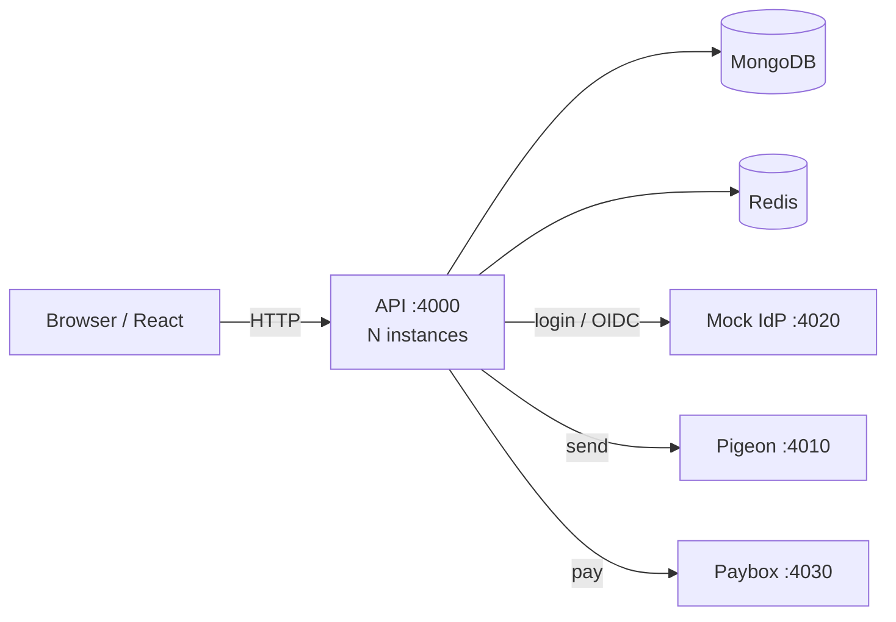
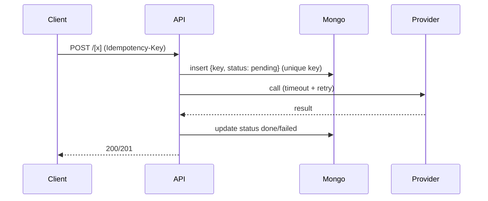

# PLAN

<!-- Fill this between 0:10 and 0:30. Update it as scope changes. -->

## 1. Scope
| Feature | Priority | Why |
|---|---|---|
| [feature] | MUST | [needed by checker / core flow] |
| [feature] | SHOULD | |
| [feature] | CUT | [reason + what happens without it] |

Build order: [1] → [2] → [3] → frontend → SHOULDs

## 2. High-level design

## 3. Flows
### Flow: [name]

Edge cases:
- [ ] Same request sent twice / retried by client →
- [ ] Provider times out or returns 5xx →
- [ ] Provider succeeds but our process dies before saving →
- [ ] Two instances handle the same thing at once →
- [ ] Mongo/Redis briefly down →
- [ ] Invalid / missing auth →

## 4. Data model
### `[collection]`
| Field | Type | Notes |
|---|---|---|
| _id | ObjectId | |
| idempotencyKey | string | **unique index** |
| status | enum | pending / done / failed |
| createdAt / updatedAt | Date | |

Indexes: [list]

### Redis
| Key | Type | TTL | Purpose |
|---|---|---|---|
| [lock:x:{id}] | string | [10s] | [prevent double processing] |

## 5. API
| Method | Path | Auth | Body | Responses | Idempotent? |
|---|---|---|---|---|---|
| GET | /healthz | no | – | 200 | yes |
| [POST] | [/x] | [yes] | [{...}] | 201, 400, 409 | [via Idempotency-Key] |

## 6. Checker results log
| Time | Passed / total | Main failures | Next fix |
|---|---|---|---|
| | | | |
